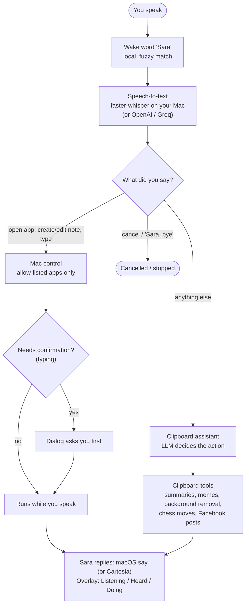

# Sara - What Siri should have been

Sara is a voice assistant for macOS that does things, not just answers. Say "Sara, open Notes" and Notes opens before you finish the sentence. It creates and edits Apple Notes, types text for you (after asking first), and turns your clipboard into a supertool: summaries, rewrites, memes, background removal, chess analysis. Born at Big Berlin Hack 2025 as a clipboard project, now a voice-controlled assistant for the whole Mac.

Runs free and local: any OpenAI-compatible LLM (the Gemini and Groq free tiers both work), local faster-whisper speech-to-text, and the built-in macOS `say` voice. No paid service required.

## How it works



Partial transcripts stream to the command rules while you talk, so safe actions start before the sentence ends. A 10-second follow-up window lets the next command skip the wake word.

## What Sara can do

### Voice control of the Mac (`run_voice.py`)

Off by default; enable with `SARA_VOICE_COMMANDS=true`.

- Wake word "Sara" with fuzzy matching ("hey sara", "ok sara"). "Sara, cancel" cancels before an action runs; "Sara, bye" (or "that was it", "thanks", "stop listening") stops her.
- Opens allow-listed apps (default: Notes, Safari, Calendar, Reminders, Finder, Music, Maps, Calculator; change with `SARA_ALLOWED_APPS`). Anything not on the list is refused.
- Creates and edits Apple Notes by voice, including "put the terminal output in the note".
- Types into the focused app, but only after you confirm in a dialog.
- Acts while you speak: partial transcripts trigger safe actions before the sentence ends, and a follow-up window (10 s by default, `SARA_FOLLOWUP_SECONDS`) lets the next command skip the wake word.
- Optional overlay pill showing Listening / Heard / Doing / Done (`SARA_OVERLAY=true`).
- Dry-run mode logs what it would do without touching the Mac (`SARA_MAC_DRY_RUN=true`).

### Clipboard assistant (`main.py`, the original version)

- Copies LLM results to the clipboard: summaries, rewrites, code, data extraction, format conversions.
- Image tools for the clipboard image: meme generator and background removal (rembg).
- Chess helper: captures the screen, reads the position, copies the best move and a short explanation.
- Posts clipboard images to a Facebook Page you manage (needs `FACEBOOK_PAGE_ID` and `FACEBOOK_PAGE_ACCESS_TOKEN`).
- Optional persistent memory across sessions (ChromaDB), off by default (`ENABLE_MEMORY=true`).

## Stack

- LLM: any OpenAI-compatible provider, configured with `SARA_LLM_BASE_URL` / `SARA_LLM_API_KEY` / `SARA_LLM_MODEL`. If a model is retired, Sara tries fallbacks; `python llm_models.py` lists what your key can use.
- Speech-to-text: local faster-whisper (`TRANSCRIPTION_PROVIDER=local`), no key, no rate limit. OpenAI or Groq as cloud options.
- Voice replies: macOS `say` by default; Cartesia optional.
- LiveKit real-time audio: optional, off by default.

## Setup

Keys live in `app/.env`, which is git-ignored. Never commit it.

- Free/local setup, no credit card: [app/FREE_LOCAL_SETUP.md](app/FREE_LOCAL_SETUP.md)
- Voice commands: 3-step test (permissions, dry run, real run): [app/VOICE_COMMANDS.md](app/VOICE_COMMANDS.md)
- Troubleshooting: [app/VOICE_TROUBLESHOOTING.md](app/VOICE_TROUBLESHOOTING.md)

```bash
cd app
pip install -r requirements.txt   # plus requirements-optional.txt for whisper / cartesia / livekit
SARA_VOICE_COMMANDS=true SARA_MAC_DRY_RUN=true python run_voice.py
```

macOS only. Needs Microphone permission, Accessibility permission (for typing), and Automation consent for Notes, all for your terminal app.

## Tests

```bash
cd app && python -m pytest
```

The voice pipeline is tested with simulated transcripts, so no microphone or API key is needed.
